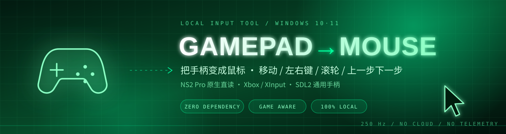
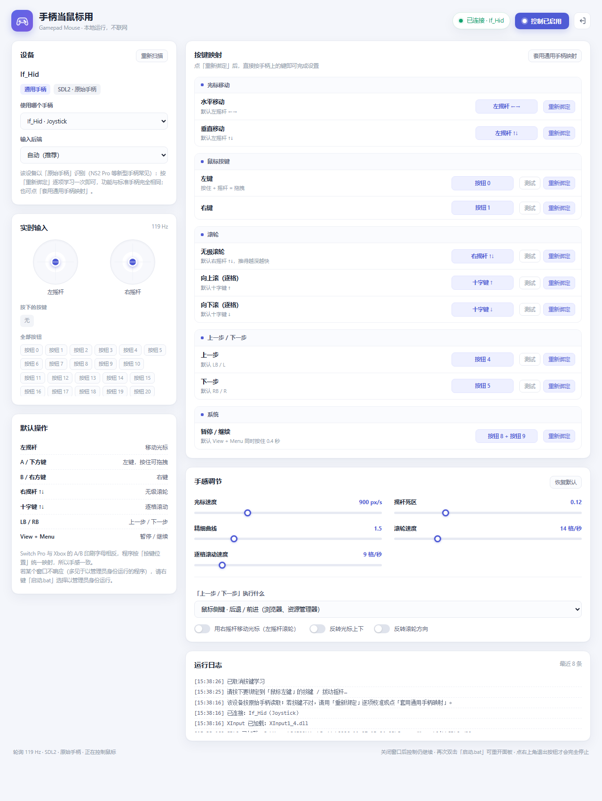
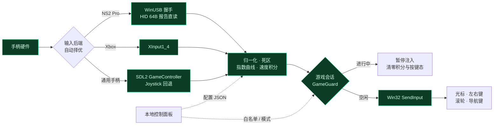

<p align="center">
  
</p>

<p align="center">
  
  
  
  
  
</p>

> **一只手柄，接管整台电脑的鼠标。**
> 左摇杆移动光标、A/B 左右键、右摇杆滚轮、肩键前进后退；**游戏一启动，它自动把手柄还给你**，连你切出去查攻略的时候也不抢。

| ▸ 开箱即用 | ▸ 不抢游戏 | ▸ 干净透明 |
| :--- | :--- | :--- |
| 双击一个 bat 就跑，不用装任何 Python 包，不用配驱动 | 以「游戏会话」为单位避让，进程没退出就一直暂停注入 | 纯本地运行，服务只监听 `127.0.0.1`，不联网、不上传、无遥测 |

---

## 目录

[使用场景](#使用场景) · [快速开始](#快速开始) · [默认操作](#默认操作) · [控制面板](#控制面板) · [实现原理](#实现原理) · [注意事项](#注意事项) · [目录结构](#目录结构)

---

## 使用场景

| 场景 | 痛点 | 这个项目怎么做 |
| :--- | :--- | :--- |
| **客厅 / 投屏 / HTPC** | 沙发到大屏好几米，键盘鼠标够不着，Air Mouse 又要额外买 | 用现成的 NS2 Pro 或 Xbox 手柄完成全部桌面操作，摇杆控速、按键点击 |
| **边玩游戏边查攻略** | 手柄映射工具常在切到浏览器时把按键也一起注入，误触一堆窗口 | 检测到游戏进程后**锁定整个游戏会话**，切浏览器、切桌面都不接管；退出游戏再延迟几秒恢复 |
| **掌机 / 小主机接显示器** | 只有手柄，没有键鼠，装系统、改设置、翻网页都很别扭 | 提供左右键、滚轮、前进后退和三种导航模式，覆盖绝大多数日常操作 |
| **展台 / 演示 / 电视盒** | 想用一只手柄讲完整场演示，不想再摆一套键鼠 | 后台常驻服务 + 独立应用窗口，关掉面板也在继续控制 |
| **临时替代输入** | 触控板坏了、手不方便用鼠标 | 摇杆速度、死区、曲线都可调，按住 A 拖拽、逐格滚轮都支持 |

---

## 快速开始

### 环境

- **Windows 10 / 11**，**64 位 Python 3.9+**（需在 `PATH` 中，命令行能执行 `python`）
- 随仓库附带 64 位 `lib/SDL2.dll`，**无需 pip install 任何东西**
- 手柄：Nintendo Switch 2 Pro、Xbox 系列（蓝牙 / 无线适配器 / USB）、以及大多数 SDL2 能识别的通用手柄

### 三步启动

```text
1  连上手柄（蓝牙或 USB）
2  双击  启动.bat
3  自动弹出「手柄当鼠标用」独立窗口 → 直接推摇杆即可移动光标
```

> 想看调试输出：用 `调试启动.bat`（保留控制台，`Ctrl+C` 停止）。
> 想验证按键有没有被识别：用 `手柄测试.bat`，会打开实时检测台 `/test`，能看到按键胶囊、摇杆圆点和 64 字节 HEX 报告流。
> 自定义端口：`python app.py --port=9000`；不弹面板：`python app.py --no-browser`。

### 停止 / 重开

- 点面板**右上角的退出按钮**才会真正结束后台服务
- 直接关掉窗口 ≠ 退出，控制仍在继续；再次双击 `启动.bat` 会重新打开同一个面板（不会起第二个实例）
- 临时暂停 / 继续：按 <kbd>View</kbd> + <kbd>Menu</kbd>（Xbox 视图键 + 菜单键）

---

## 默认操作

| 手柄输入 | 系统动作 | 说明 |
| :--- | :--- | :--- |
| 左摇杆 | 移动光标 | 速度按「像素/秒」积分，与帧率无关；可在面板调节 |
| <kbd>A</kbd> / 下方键 | 鼠标左键 | 按住可拖拽 |
| <kbd>B</kbd> / 右方键 | 鼠标右键 | — |
| 右摇杆 ↑↓ | 无级滚轮 | 推得越多滚得越快 |
| 十字键 ↑↓ | 逐格滚轮 | 适合菜单、列表精确滚动 |
| <kbd>LB</kbd> / <kbd>RB</kbd> | 上一步 / 下一步 | 行为可切换，见下表 |
| <kbd>View</kbd> + <kbd>Menu</kbd> | 暂停 / 继续接管 | 组合键，边沿触发不会连发 |

> Switch Pro 与 Xbox 的 **A/B、X/Y 印刷字母正好相反**。程序按「按键位置」统一映射：**下方键永远是左键，右方键永远是右键**，换手柄手感一致。

**「上一步 / 下一步」的三种模式**（面板里随时切换）：

| 模式 | 实际按键 | 适用 |
| :--- | :--- | :--- |
| `side_buttons`（默认） | 鼠标 X1 / X2 侧键 | 浏览器、资源管理器 |
| `undo_redo` | `Ctrl+Z` / `Ctrl+Y` | 编辑器里撤销 / 重做 |
| `alt_arrows` | `Alt+←` / `Alt+→` | 部分软件的前进后退 |

---

## 控制面板

本地网页面板（`http://127.0.0.1:8765/`，以独立应用窗口打开），所有设置即时生效并写入 `config.json`：

- **设备**：自动 / 手动选择手柄，切换输入后端（自动 / NS2 原生直读 / 仅 SDL2 / 仅 XInput），重新扫描
- **按键映射**：点「重新绑定」后直接按手柄上的键（或拨摇杆、按十字键）完成学习，12 秒无操作自动取消；一键套用通用手柄映射
- **手感**：光标速度 `100~3000 px/s`、死区 `0~0.45`、指数曲线 `1.0~3.5`、滚轮速度；交换左右摇杆、反转移动 / 滚轮方向
- **游戏模式**：严格 / 宽松 / 关闭，恢复延迟，手动游戏名单，当前有窗口的程序列表，误判时「临时恢复控制」
- **NS2 状态条**：唤醒手柄、校准摇杆中心、打开按键检测台
- **实时输入 / 日志**：两个摇杆圆点、按下的按键、最近 8 条运行日志

<p align="center">
  
</p>

<details>
<summary><b>本地 HTTP 接口</b>（给想二次开发的人）</summary>

| 方法 | 路径 | 用途 |
| :--- | :--- | :--- |
| `GET` | `/api/state` | 设备、输入、游戏避让、统计、日志的状态快照 |
| `GET` | `/api/health` | 健康检查 |
| `GET` | `/` · `/test` | 控制面板 · 按键检测台 |
| `POST` | `/api/config` | 合并更新配置并落盘 |
| `POST` | `/api/cmd` | 暂停 / 恢复、重新扫描、按键学习、退出等命令 |
| `GET` | `/api/probe` · `/api/games` | NS2 探针状态 · 游戏会话状态 |
| `POST` | `/api/probe/init` · `/api/probe/clear` · `/api/probe/recenter` | 唤醒 · 清空事件 · 校准中心 |
| `POST` | `/api/games` | 添加 / 删除游戏名单 |

服务只绑定回环地址，不监听外网端口。

</details>

---

## 实现原理



**① 输入层 — 三条后端自动兜底**

`SDL2.dll` 负责标准手柄（GameController 映射失败时回退到 raw Joystick），`XInput1_4.dll` 负责 Xbox，`core/ns2.py` 专门为 **Switch 2 Pro（VID `057E` / PID `2069`）** 做原生直读——SDL2 2.32 还不认识这个 PID。NS2 Pro 上电后默认沉默，需要先经厂商接口（`MI_01` / WinUSB）发送 SDL3 官方驱动里的 **10 条初始化命令**，才会开始输出 **64 字节 / 250 Hz** 的 `report 0x05`；随后解析按钮位与 12-bit 打包摇杆，再按「按键位置」语义统一成标准 axes / digital。全过程只用 `ctypes` + Windows 系统库，不需要 libusb 或 SDL3。

**② 处理层 — 从摇杆到像素**

先减死区，再过指数曲线（曲线越大小幅推动越精细），最后按 **像素/秒 × dt** 积分成相对位移，所以快慢与轮询帧率解耦。按键用边沿检测，按下 / 抬起各触发一次，长按不会连发；`View+Menu` 这类组合键单独判定。

**③ 摇杆中心自校准**（解决「光标自己往右上飘」）

刚唤醒的前几帧摇杆字段还是过渡值，若拿它当中心，静止时就会被算成持续推某个方向。实现上跳过启动过渡帧、只在四轴连续静止 0.8 秒且读数落在物理回中区间（`1650~2450`）时才重设中心，再加硬零区；中心持久化到 `stick_center.json`，重启直接复用，也可在面板手动校准。

**④ 注入层 — Win32 `SendInput`**

移动用相对位移 `MOUSEEVENTF_MOVE`，左右键用 down/up 成对注入（支持按住拖拽），滚轮、X1/X2 侧键、`Ctrl+Z/Y`、`Alt+←/→` 各自组装 `INPUT` 结构。全部走系统级输入队列，对绝大多数桌面程序等价于真实鼠标。

**⑤ 游戏避让 — 判定「会话」而不是「前台窗口」**

多信号识别：手动白名单 → 游戏平台目录（Steam / Epic / XboxGames / GOG / EA / Riot 等）→ 全屏前台窗口 → 系统 `SHQueryUserNotificationState`。同时排除启动器、崩溃上报、反作弊等辅助进程，以及浏览器 / 播放器 / OBS 等非游戏程序。**一旦锁定某个游戏进程，只要它还活着就一直暂停**，哪怕你 Alt+Tab 出来查攻略；进程退出后再宽限 2 秒恢复，避免切关卡抖动。暂停时清零速度积分与按键状态，恢复首帧只重建基线，因此不会突跳或残留按键。

**⑥ 界面 — 本地服务 + 原生窗口**

Python 标准库 `ThreadingHTTPServer` 提供静态页面与 JSON API，Edge / Chrome 以 `--app` 模式开成无地址栏的独立窗口；单例互斥锁防止重复启动；配置以 JSON 落盘，运行时文件不入库。

---

## 注意事项

1. **平台限制**：仅 Windows 10/11 + **64 位** Python；`lib/SDL2.dll` 必须同为 64 位，否则加载失败会弹错误框并把堆栈写进 `error.log`。
2. **管理员权限窗口收不到注入**：Windows 的 UIPI 会拦截低权限进程向高权限窗口发输入。若某个程序没反应，右键 `启动.bat` →「以管理员身份运行」。
3. **NS2 Pro 首次连接**：面板里点「唤醒手柄」；若 Steam 正独占厂商接口，程序会跳过握手、直接读 HID 报告（此时 Steam 通常已完成唤醒）。若仍无数据，先退出 Steam 再试，或改用 `/test` 检测台看 HEX 报告。
4. **光标自己飘**：松开两个摇杆，点 NS2 状态条的「校准摇杆中心」；校准值存在 `stick_center.json`。
5. **游戏开着时顶部橙色横幅是预期行为**：严格模式下切到浏览器查攻略也不会接管；急用可点「临时恢复控制」，或在「游戏模式」里改成宽松 / 关闭。自动识别以 `.exe` 为准，遇到误判可手动加名单。
6. **关窗口不等于退出**：服务在后台继续控制鼠标，要完全停止请点面板右上角退出按钮（调试窗口则按 `Ctrl+C`）。
7. **蓝牙有延迟**：追求稳定低延迟建议 USB 连接；检测台里可观察实际报告频率。
8. **配置文件不入库**：`config.json`、`stick_center.json`、`runtime.json`、`error.log` 每台机器各不相同，已在 `.gitignore` 中排除；删掉 `config.json` 即恢复默认设置。
9. **第三方组件**：`lib/SDL2.dll` 来自 SDL2（zlib 许可，允许再分发），初始化序列与报告格式参考 SDL3 的 `SDL_hidapi_switch2.c`；本项目其余源码未单独声明许可证，再分发前请先与作者确认。

---

## 目录结构

<details>
<summary>展开文件树</summary>

```text
GamepadMouse/
├── app.py                 入口：本地服务、单例、打开应用窗口、退出清理
├── server.py              HTTP 服务与 JSON API
├── core/
│   ├── engine.py          轮询主循环、设备调度、输入处理、状态与命令
│   ├── config.py          默认值、类型/范围校验、JSON 持久化
│   ├── sdl2.py            SDL2 ctypes 封装（GameController / Joystick）
│   ├── xinput.py          XInput1_4 兜底
│   ├── ns2.py             NS2 Pro：WinUSB 握手、64B 报告解析、中心校准
│   ├── gameguard.py       游戏会话检测与避让状态机
│   └── wininput.py        Win32 SendInput 注入
├── web/                   控制面板、检测台、样式与图标
├── lib/SDL2.dll           64 位 SDL2 运行库
├── assets/hero.svg        本页头图
├── 界面预览.png
├── 启动.bat · 调试启动.bat · 手柄测试.bat
└── .gitignore · .gitattributes
```

</details>

---

<p align="center">
  <b>Gamepad Mouse</b> · 用一只手柄，把桌面也一起接管 <br>
  <sub>本地运行 · 零依赖 · 游戏优先</sub>
</p>
